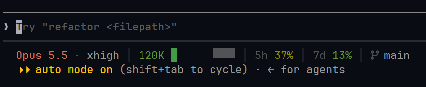
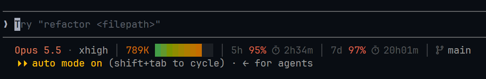

# claude-code-statusline

A fast, single-file Python status line for [Claude Code](https://claude.com/claude-code).



From left to right:

- **Model** and reasoning effort
- **Context window**: tokens in use and a bar that goes from green through amber to red
- **Usage limits** for 5 hours and 7 days, plus the time left until reset once a limit reaches 70 % (adjustable for each limit or shown always)
- **Git branch** of the working directory (short commit hash when detached)

As the context window fills, the bar runs into red, and a usage limit near its end shows the time left until it resets:



A segment without data is left out. A segment that fails shows `<name>: err` instead, so one problem never blanks the whole line.

## Requirements

- Python 3.11 or newer, standard library only (nothing to install)
- A terminal with 24-bit color and a [Nerd Font](https://www.nerdfonts.com/) (for the branch and timer icons)

## Setup

1. Download the script to `~/.claude/statusline.py`:

   ```sh
   curl -o ~/.claude/statusline.py https://raw.githubusercontent.com/Mmathieus/claude-code-statusline/main/statusline.py
   ```

   In Windows PowerShell 5.1, where `curl` is an alias for another command:

   ```powershell
   curl.exe -o "$HOME\.claude\statusline.py" https://raw.githubusercontent.com/Mmathieus/claude-code-statusline/main/statusline.py
   ```

2. Add to the top-level object in `~/.claude/settings.json`:

   ```json
   "statusLine": {
     "type": "command",
     "command": "python -I -S -X utf8 -c \"import os, sys; sys.path.append(os.path.expanduser('~/.claude')); import statusline; statusline.main()\"",
     "refreshInterval": 10
   }
   ```

   Where Python is installed as `python3` (macOS, most Linux), write `python3` instead.

The command is long because Python starts anew on every update, so it is built to start as fast as possible. On Windows a run takes about 70 ms. The comment at the top of [`statusline.py`](statusline.py) explains each flag, how the script works and its limitations.

## Customizing

The `SETTINGS` section near the top of the script holds the bar width, the gradient colors, the icons and, for each usage limit, the percentage from which the reset time is shown (`RESET_TIME_FROM_5H`, `RESET_TIME_FROM_7D`; `0` shows it always). To drop or reorder segments, edit the `SEGMENTS` tuple.

## Notes

- Usage limits are reported only for Claude Pro and Max subscriptions
- Developed and timed on Windows 11. Nothing in it is specific to Windows, so macOS and Linux should behave the same. If something is off, please open an issue

## Credits

The code was written by Claude Opus 5.5 in Claude Code. Design, testing and review are mine.

## License

[MIT](LICENSE)
